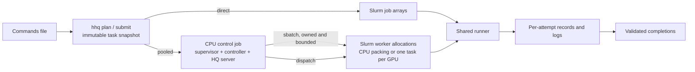

# hyper-hyperqueue

`hhq` is a thin, configurable Slurm layer around [HyperQueue](https://github.com/It4innovations/hyperqueue) (HQ). You give it a file of shell commands. It snapshots them as immutable tasks, previews the plan, and runs them in one of two ways:

- **Direct**: Slurm job arrays with one command per element by default. HQ is not needed.
- **Pooled**: a small CPU control job runs an HQ server and a controller. The controller submits long-lived Slurm worker allocations, and HQ hands each worker the next compatible command.

Slurm controls allocations and HQ dispatches tasks. `hhq` is the only thing that submits worker allocations; HQ's own allocation manager is not used.



## Install

You need Python 3.11–3.13, [uv](https://docs.astral.sh/uv/), and access to a Slurm cluster.

```bash
git clone https://github.com/SethWoodbury/hyper-hyperqueue.git hyper-hyperqueue
cd hyper-hyperqueue
uv sync                 # core + direct mode; HQ is not required
uv run hhq --help
```

Pooled mode also needs HyperQueue **0.26.2**:

```bash
uv sync --all-extras    # adds the pinned `hyperqueue` Python package
```

Install the matching `hq` executable separately, once, on shared storage. `hhq` looks for it in this order: `control.hq_binary` in the config, then `HHQ_HQ_BINARY`, then `hq` on `PATH`, then `~/.local/share/hyper-hyperqueue/hq/0.26.2/hq`. Workers never download or build software at startup. [ADR 001](docs/decisions/001-hyperqueue-boundary.md) lists the upstream artifact and its checksums.

## Getting started

1. **Describe your cluster.** Copy [`examples/cluster.yaml`](examples/cluster.yaml) to a private location outside the repository and edit its partitions, GRES, budgets and `state_dir`. Put `state_dir` on durable shared storage, outside this checkout. `hhq discover` reads the cluster configuration to help with this; it submits and cancels nothing.

   ```bash
   export HHQ_CONFIG=/path/to/private/cluster.yaml   # or pass --config
   uv run hhq discover --output-dir /path/to/private/discovery
   uv run hhq doctor
   uv run hhq config show --resolved
   ```

   Profiles such as `cpu-pool` or `gpu-flex` are names you define in the config, not Slurm partitions. Budgets and caps are your own operator settings, not site limits.

2. **Write commands.** Each nonblank, non-comment line is one task, and the runner keeps its quoting exactly. See [`examples/cpu_commands.txt`](examples/cpu_commands.txt). Use `--format jsonl` for multiline commands or argv lists.

3. **Preview, then submit.** `plan` and `submit --dry-run` never submit or cancel jobs.

   ```bash
   # Direct: one Slurm array element per command
   uv run hhq plan   examples/cpu_commands.txt --mode direct --profile cpu-direct --mem 1GiB
   uv run hhq submit examples/cpu_commands.txt --mode direct --profile cpu-direct \
     --mem 1GiB --time 00:15:00 --max-attempts 2 --name first_direct

   # Pooled: CPU control job + reusable workers (needs HQ)
   uv run hhq plan   examples/cpu_commands.txt --mode pooled --profile cpu-pool --runtime 10
   uv run hhq submit examples/cpu_commands.txt --mode pooled --profile cpu-pool \
     --runtime 10 --max-attempts 2 --name first_pool
   ```

4. **Watch it.**

   ```bash
   uv run hhq status --reconcile
   uv run hhq explain TASK_ID
   uv run hhq logs TASK_ID --stderr
   uv run hhq ui            # prints a private, token-protected loopback URL
   ```

The Python API in [`examples/notebook_api.py`](examples/notebook_api.py) exposes the same plan/submit calls.

## Direct or pooled?

|  | Direct | Pooled |
| --- | --- | --- |
| Needs HQ | No | Yes (pinned 0.26.2) |
| Scheduling unit | Slurm array element | Individual task on a long-lived worker |
| Good for | Long or MPI/multi-node commands; no service to keep alive | Many short commands, CPU packing, GPU campaigns |
| Control service | None; arrays keep running if your terminal closes | One CPU control job that owns its workers |
| GPUs | Allowed | One command per assigned GPU at a time |

`--mode auto` uses declared runtimes and profile settings. `hhq plan` explains its choice and lists the profiles it rejected. See [CPU direct vs pooled](docs/cpu-direct-vs-pooled.md).

In pooled mode, the controller reconciles on a fixed interval. It submits workers only while there is compatible waiting work, and always within each profile's `max_workers` and each budget's `max_submitted`. It does not try to predict when nodes will free up. Optional controls for pending-worker floors, budget priority order, fast refill and multi-partition speculation are covered in [architecture](docs/architecture.md) and [operations](docs/operations.md).

For a finite batch, opt in with `control.stop_when_complete: true`. With early drain enabled, it cancels owned surplus pending workers once all work is actually assigned. Running workers finish and idle out; once every task and retry is settled, the control service shuts down.

## Correctness model

- **Immutable tasks.** An import snapshots command bytes and settings. Re-importing the same thing is idempotent. Duplicate lines are still separate tasks. Changed inputs become a new generation.
- **Success means validated.** A finished Slurm allocation does not mean its commands succeeded. Each task gets durable attempt records, and completion requires exit 0 plus any configured output checks. The API supports expected files, minimum sizes, validator commands and output modes.
- **Bounded retries.** The default is one attempt. `hhq retry CAMPAIGN --failed` never raises the attempt bound you set at import. Interrupted work is replayed only when its output policy, repeatability and positive termination evidence allow it.
- **Uncertainty fails closed.** A submission that Slurm may have accepted without acknowledging stays reserved until it is reconciled; `hhq` never blindly submits a second copy. Stale heartbeats never authorize takeover.

## Recovery

Every attempt is durable, so work can be resumed or recovered without rerunning commands that already succeeded:

- `hhq resume CAMPAIGN` resumes admission. Successful tasks are skipped.
- To change resources, prepare a **remaining-only** generation: `hhq export-remaining` followed by `hhq submit --recovery-manifest`. This keeps the original commands, validators and identities, and retires the exported tasks in the old campaign.
- Optional host-OOM recovery uses an explicit RAM ladder relative to the original request; it never increases host RAM for a GPU VRAM error.
- Optional cumulative GPU-hour ceilings include a configurable allowance and conservative reservations for pending/running allocations.
- Controller restarts, planned control-job renewal and optional standby have strict ownership prerequisites.

This area is under active development. Read [recovery](docs/recovery.md) and [limitations](docs/limitations.md) before relying on any automatic behavior, and never recover by replaying the original full command file with new resources.

## Model-warm bundles and the optional RFD4 adapter

The generic scheduler knows nothing about any particular application. The optional adapter under `src/hyper_hyperqueue/integrations/rfd4` turns a saved RFD4 sweep manifest into immutable task **bundles**: compatible rows run one after another in the same Python process, so imports and setup are reused. Optional settings group bundles by recipe, set method execution order and reuse models across rows. Warm execution needs qualification for the chosen model, inputs and container; cached objects do not guarantee continuous GPU residency. Preparation is separate from launch, and native seeds, inputs and output paths are preserved. See the [RFD4 guide](docs/rfd4.md) and [`hhq rfd4 --help`](src/hyper_hyperqueue/integrations/rfd4/cli.py).

## Operating

```bash
uv run hhq service status
uv run hhq campaign drain CAMPAIGN_ID          # stop new admissions; admitted work continues
uv run hhq pool pause PROFILE --scope allocations
uv run hhq pool resume PROFILE
uv run hhq append CAMPAIGN_ID more_commands.txt
uv run hhq cancel CAMPAIGN_ID --pending --running
uv run hhq service stop                        # drain, then stop
uv run hhq metrics                             # advisory; never changes requests
```

The dashboard (`hhq ui`) is optional and read-only by default. It binds only to loopback and never polls Slurm or makes recovery decisions. `hhq ui --export FILE.html` writes an offline snapshot; note that exports contain private campaign metadata.


*Dashboard example uses synthetic records, not scientific results.*

## Documentation

- [Architecture and ownership](docs/architecture.md): execution paths, state layout, resource meanings, pending/priority/fill policies
- [Operations](docs/operations.md): configuration, imports and outputs, controls, tuning, diagnosis
- [CPU direct vs pooled](docs/cpu-direct-vs-pooled.md)
- [Recovery](docs/recovery.md) and [limitations](docs/limitations.md)
- [Dashboard](docs/dashboard.md) and [CPU hosting template](examples/dashboard.sbatch)
- [Cluster discovery](docs/cluster-discovery.md)
- [RFD4 adapter](docs/rfd4.md), [marimo example](examples/rfd4_notebook.py), [options template](examples/rfd4_options.yaml)
- [Native RFD4 comparison and remaining differences](docs/native-rfd4-comparison.md)
- [Example site limits and billing interpretation](docs/site-example-digs.md)
- [Validation evidence](docs/validation.md): real integration results, kept separate from unit tests
- [Design decisions](docs/decisions/)

## Development

```bash
uv sync --all-extras
uv run ruff check src tests examples
uv run pytest
```

HQ integration tests need the separately installed pinned `hq` executable. Use bounded synthetic tests for scheduler behavior; qualify scientific applications separately with explicit authorization.

## License

MIT; see [LICENSE](LICENSE). HyperQueue and other dependencies keep their own licenses.
