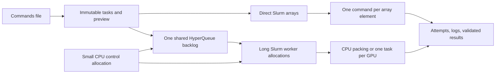

# hyper-hyperqueue

A small Slurm allocation layer around [HyperQueue](https://github.com/It4innovations/hyperqueue), with a separate direct-array path. Generate a commands file, preview it, and submit it. Slurm owns placement and queueing; HyperQueue dispatches individual commands inside pooled allocations.



**Direct CPU is first-class:** no HQ package, server, or daemon is needed. **Pooled CPU and GPU are first-class:** workers take the next compatible task immediately, without fixed command batches. A controller reconciles allocations every 45 seconds by default; it does not predict when nodes will become free.

## Install

```bash
cd /home/woodbuse/git/hyper-hyperqueue
uv sync --all-extras --locked
uv run hhq --help
```

Python 3.12 is used here. Direct-only installation is `uv sync` (HQ is optional). Pooled execution needs the separately installed **HQ 0.26.2 executable** and matching Python extra. The verified binary on this installation is at `$HOME/.local/share/hyper-hyperqueue/hq/0.26.2/hq`. Version, upstream artifact and checksums are recorded in [ADR 001](docs/decisions/001-hyperqueue-boundary.md). Environments are installed once on shared storage; workers never download packages.

## Start here on this cluster

The actual discovered configuration is private and gitignored:

```bash
export HHQ_CONFIG=/home/woodbuse/git/hyper-hyperqueue/.local/cluster.yaml
uv run hhq doctor
uv run hhq config show --resolved
```

It defines `cpu-direct`, `cpu-pool`, `cpu-backfill`, `gpu-small`, `gpu-large`, `gpu-backfill`, and `gpu-train`. `gpu-flex` is a workload alias for the four GPU profiles, **not a partition**. Bootstrap budgets are deliberately small, explicit operator settings, not alleged site limits. Review them before a large campaign. Existing scientific campaigns were not migrated or altered.

Direct CPU, one command per array element:

```bash
uv run hhq plan examples/cpu_commands.txt --mode direct --profile cpu-direct --mem 1GiB
uv run hhq submit examples/cpu_commands.txt --mode direct --profile cpu-direct \
  --mem 1GiB --time 00:15:00 --max-parallel 2 --max-attempts 2 --name first_direct
uv run hhq status --reconcile
```

Pooled CPU, using a CPU-hosted control job and CPU workers:

```bash
uv run hhq plan examples/cpu_commands.txt --mode pooled --profile cpu-pool --runtime 10
uv run hhq submit examples/cpu_commands.txt --mode pooled --profile cpu-pool \
  --runtime 10 --max-attempts 2 --name first_pool
uv run hhq service status
uv run hhq status
# Substitute the campaign ID returned by submit:
uv run hhq append CAMPAIGN_ID examples/more_commands.txt
```

GPU commands use the same interface:

```bash
uv run hhq plan /absolute/path/gpu_commands.txt --mode pooled --profile gpu-flex \
  --mem 12GiB --runtime 600
# Run submit with the same arguments after reviewing the preview.
```

The local GPU profiles request 8-hour allocations; `gpu-train` requests 12 hours, within a 24-hour CPU control allocation. Tasks retain individual identities. Small campaigns may need only one worker; large backlogs can use many configured workers. Actual remaining control/worker walltime limits dispatch. No GPU-sharing policy is enabled: one GPU runs one command at a time.

## Inspect and control

```bash
uv run hhq explain TASK_ID
uv run hhq logs TASK_ID --stderr
uv run hhq metrics
uv run hhq ui                         # http://127.0.0.1:8765
uv run hhq campaign drain CAMPAIGN_ID # stop new admissions; admitted work continues
uv run hhq pool pause gpu-large --scope allocations
uv run hhq pool resume gpu-large
uv run hhq retry CAMPAIGN_ID --failed # within the original attempt bound
uv run hhq resume CAMPAIGN_ID        # also feeds unsent direct-array chunks
uv run hhq service stop              # drain control service
```

`plan` and `submit --dry-run` never submit or cancel a job. Repeating an identical import is idempotent; duplicate lines *within* a file remain distinct tasks. Changed inputs create a new generation. A successful Slurm allocation is not proof that all commands succeeded: durable per-task results and validators decide that.

Submissions default to one total attempt. The synthetic examples explicitly allow two; `retry --failed` cannot exceed the original bound. Automatic interrupted replay additionally requires a declared safe output/repeatability policy and positive termination evidence.

The browser provides campaign/task/attempt pages, bounded log tails, allocation scripts, pool snapshots, recent events and measurements. It binds loopback only. It is optional and does not keep jobs alive.

## Recovery and validation

The supervisor can restart its controller while HQ stays alive. Replacing an HQ server requires a new epoch, verified exclusion, and explicit handling of old workers. Optional active/standby control jobs are gated on an expiring readiness receipt for the **exact tested state directory**. A stale heartbeat or an empty queue is never permission to take over.

Production standby is **disabled by default**. See [validation evidence](docs/validation.md) for the actual local and cluster results, and [recovery](docs/recovery.md) for tested behavior and activation prerequisites. Unknown submissions stay reserved until their exact identity is reconciled; the system does not blindly submit a second copy.

## Documentation

- [Architecture and ownership](docs/architecture.md)
- [CPU direct versus pooled](docs/cpu-direct-vs-pooled.md)
- [Operations, configuration and migration](docs/operations.md)
- [Cluster discovery](docs/cluster-discovery.md)
- [Recovery](docs/recovery.md)
- [Limitations](docs/limitations.md)
- [Python example](examples/notebook_api.py) and [sanitized configuration](examples/cluster.yaml)

```bash
uv run pytest -q
uv run ruff check src tests examples
uv build
```

MIT, Copyright (c) 2026 Seth Woodbury. Dependencies retain their own licenses. No remote repository has been published.
