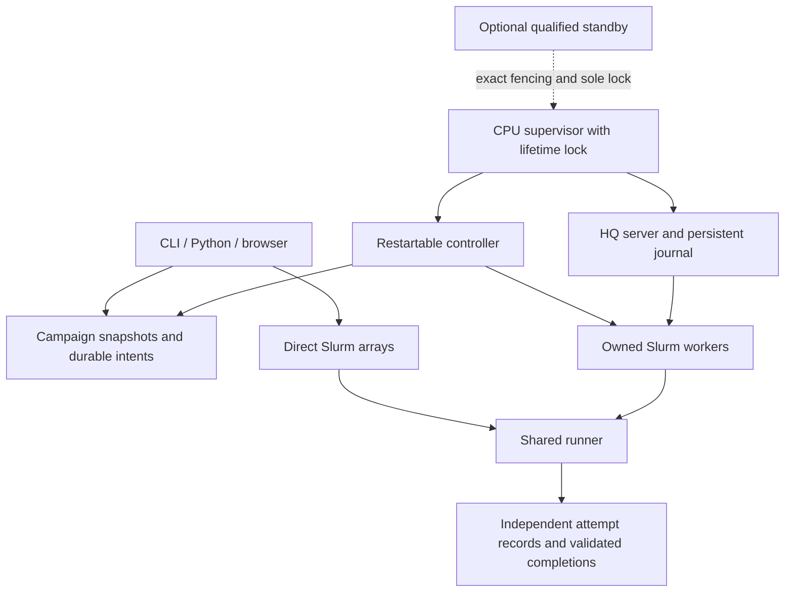

# Architecture

The boundary is deliberately small: Slurm places allocations, HyperQueue schedules commands inside workers, and hhq records identities and decides when another allocation is useful. HQ's native allocation manager is not enabled. There is exactly one worker-allocation owner.

## Execution paths

Direct submission snapshots the commands file, assigns stable occurrence IDs, and creates homogeneous Slurm arrays. Each slot reads its small task mapping and invokes the common runner. `commands_per_job=1` is the default. An optional sequential group preserves old batching without losing per-command outcomes. No HQ process or import is required.

Pooled submission snapshots the same task schema. A CPU-hosted supervisor runs one HQ server and a separate controller subprocess. The controller admits individual tasks and creates long worker allocations, using one shared backlog across eligible CPU/GPU profiles. CPU resources and RAM are logical HQ quantities; Slurm/cgroups provide the physical boundary. GPU workers advertise only the device actually assigned, retain GPU visibility, and allow one command at a time.

The controller is not a node-availability predictor. A pure function consumes declared work, estimated durations, existing worker lifetimes, pending reservations, profile weights and explicit shared budgets. It returns a bounded action list. Compatible work is consumed once when estimating capacity, rather than independently counted for every eligible GPU class. Existing pending jobs retain their place in Slurm.

## Ownership and failure boundaries



All coordinated metadata mutations use the same short-lived state lock; client mutations cannot race controller mutations. Workers write independent attempt/result files under per-task locks. A separate lifetime lock protects the HQ journal and active submitter. Epoch checks reject delayed old work, but do not substitute for physical fencing.

An intent is durable before either backend is called. Unknown backend responses retain the reservation and block unsafe growth/replay. Slurm ownership uses the exact token in comment and full job-name suffix, plus the user; this site's accounting drops comments. HQ ownership uses its unique job name and durable mapping.

## State layout

Runtime state is external to Git. Principal records are:

```text
STATE/
  campaigns/CAMPAIGN/
    campaign.json
    imports/IMPORT/{source,manifest.json}
    tasks/TASK.json
    task_states/TASK.json
    attempts/TASK/ATTEMPT/{attempt.json,result.json,stdout,stderr,output/}
    completions/TASK.json
  submissions/TOKEN/          rendered scripts, mappings, backend receipts
  intents/                   durable allocation/admission reservations
  service/                   leader epochs, deployment, HQ credentials/journal
  events.jsonl               sequenced events; private metadata
  controller_status.json     timestamped decision/health snapshot
```

Use the paths returned by the API rather than reconstructing implementation filenames. Full commands, environments, and credentials stay private. The support bundle exports only an allowlisted summary.

Atomic rename and fsync protect individual durable records. They do not create a distributed transaction with Slurm or HQ. NFS locking and cache behavior must be qualified on the actual state path. No SQLite WAL is used. See [ADR 003](decisions/003-state-storage.md).

## Resource meanings

`Resources` describes one task; `Profile` describes one Slurm allocation. `Budget` describes a shared allowance across profiles. Host RAM (`memory_mib`) is independent of GPU VRAM (`min_vram_mib`). `runtime_seconds` is an estimate, `timeout_seconds` kills a task at its deadline, and `allocation_seconds` requests scheduler walltime. These are intentionally separate.

`running_target` is a planning target, not an enforceable instantaneous running cap. `max_submitted` bounds outstanding reservations; external current-user jobs sharing that scope count by default. Multiple scopes can conservatively count the same allocation where it consumes both allowances. Slurm remains authoritative for site limits and fair-share. Direct `max_parallel` reserves a strict aggregate throttle across outstanding arrays, with explicit unsent remainder when needed.

Measurement summaries group successful tasks by workload, software, CPU allocation, actual GPU, and known concurrency/cache context. Suggestions are advisory; no optimizer silently changes scientific commands or resources. Unknown measurements stay unknown.
