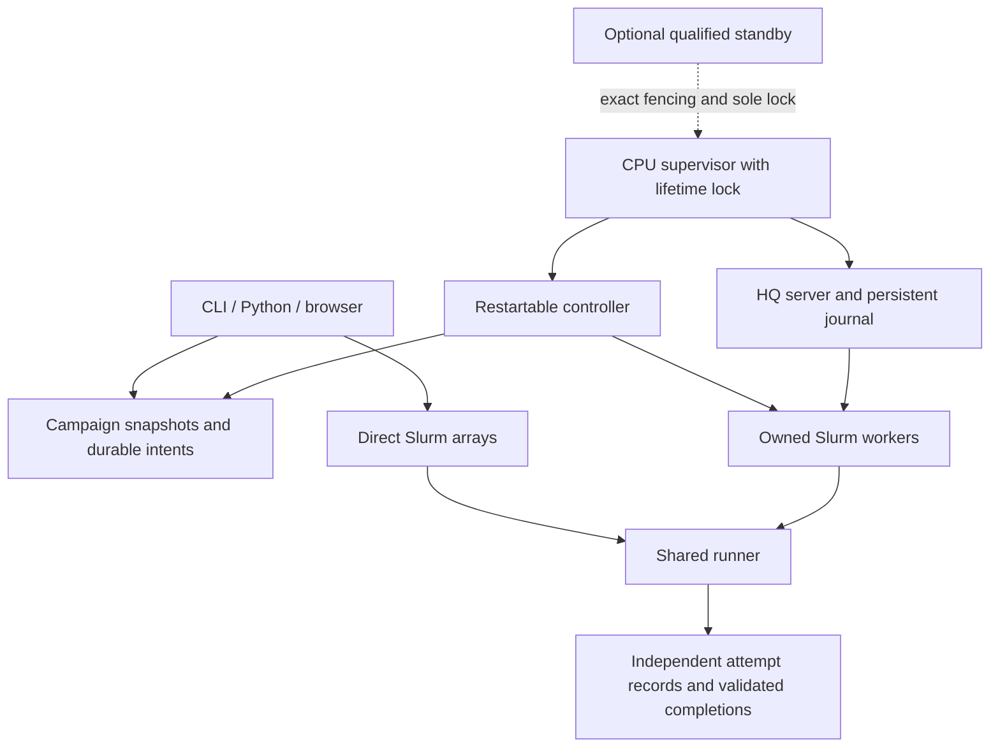

# Architecture

The boundary is deliberately small: Slurm places allocations, HyperQueue schedules commands inside workers, and hhq records identities and decides when another allocation is useful. HQ's native allocation manager is not enabled. There is exactly one worker-allocation owner.

Optional workload adapters live under `integrations/` and call the same generic APIs. The [RFD4 adapter](rfd4.md) separates preparation, scientific runtime and submission; it does not add a scheduler. Application checkpoints and caches belong to the native application. The runner remains the authority for retry eligibility.

## Execution paths

Direct submission snapshots the commands file, assigns stable occurrence IDs, and creates homogeneous Slurm arrays. Each slot reads its small task mapping and invokes the common runner. `commands_per_job=1` is the default. An optional sequential group preserves old batching without losing per-command outcomes. No HQ process or import is required.

Pooled submission snapshots the same task schema. A CPU-hosted supervisor runs one HQ server and a separate controller subprocess. The controller admits individual tasks and creates long worker allocations, using one shared backlog across eligible CPU/GPU profiles. CPU resources and RAM are logical HQ quantities; Slurm/cgroups provide the physical boundary. GPU workers advertise only the device actually assigned, retain GPU visibility, and allow one command at a time.

The controller is not a node-availability predictor. A pure function consumes declared work, estimated durations, existing worker lifetimes, pending reservations, profile weights and explicit shared budgets. It returns a bounded action list. Compatible work is consumed once when estimating capacity, rather than independently counted for every eligible GPU class. Existing pending jobs retain their place in Slurm.

An optional budget `min_pending` maintains a separate pooled-worker pending floor.
The controller counts queue-confirmed pending/running jobs separately; unconfirmed
owned submissions reserve slots until reconciliation. When pending jobs start, it
replenishes their budget's floor on subsequent cycles, even if running workers
could eventually process the whole backlog. Profiles in the same budget share one
floor. Running capacity is not a promise that Slurm will start a particular number
of workers.

Each reserve worker needs a distinct compatible waiting-task anchor across the
shared backlog. A small or exhausted backlog therefore tapers the reserve, and
disabled/paused or incompatible profiles create no workers. These are capacity
estimates, not exclusive task assignments: HQ still dispatches the shared tasks.
Hard `max_submitted` budgets (including overlapping scopes and external user jobs),
profile `max_workers`, submission-rate limits, and control lifetime remain binding.
The controller's `pending_reserves` report separates observations, uncertainty,
planned submissions, remaining deficits, and blocker reasons. The dashboard Pools
page displays this cached report without querying Slurm.

`min_pending: 0` retains the previous demand-sized behavior. `pending_reserve`
remains the legacy addition to the normal `running_target` admission ceiling;
it is not the pending-floor switch. Opted-in pending replenishment may exceed that
soft ceiling but never the explicit `max_submitted` limit.

`policy.budget_priority` optionally lists budget names in preferred submission
order, for example `[gpu, gpu-train, gpu-bf]`. Pending deficits are replenished in
that order; additional demand-based growth uses the same preference afterward.
A satisfied, paused, capped, or incompatible route yields to the next one. This
is not a barrier waiting for higher-priority jobs to start or finish: all enabled
partitions can run concurrently. Unlisted budgets follow the listed ones; an
empty list preserves the prior weighted ordering. This does not change Slurm's
own scheduling priority. Reconciliation defaults to 15 seconds with at most four
new worker submissions per cycle. Both the burst limit and submission cooldown
are configurable; one cycle submits its bounded list sequentially without a
reconciliation-interval sleep between workers. A rejected or ambiguous submission
stops that burst.

For rapid expansion, `budget.fill_running_target: true` changes the effective
pending target to `max(min_pending, running_target - observed_running)`. This
queues capacity for the running target before waiting for Slurm to start workers,
instead of packing all estimated work into a few long allocations. Every proposed
worker still needs a distinct compatible waiting task; shared demand, profile caps
and hard budgets remain binding. Set `policy.max_submissions_per_cycle` high enough
for the desired burst and choose `policy.submit_cooldown_seconds` explicitly.
Defaults preserve the earlier demand-sized behavior. A target is not a strict
running cap: Slurm may start the pending reserve too.

`policy.speculative_partition_workers: true` optionally gives each Slurm
partition its own waiting-task capacity pool. Positively observed pending workers
in one partition no longer prevent another partition from queuing workers for
that same waiting work. Profiles within a partition still share their pool;
ambiguous submissions remain globally reserved. The actual HQ task pool is
unchanged and commands are not imported twice. This favors elapsed completion
time when queue availability is unknown, at the cost of possible excess idle
workers if several partitions start simultaneously. Hard budgets, burst limits,
idle exit and completion cleanup still apply. Default false keeps global demand
conservation; plan output labels the mode and reused capacity anchors.

## Ownership and failure boundaries



All coordinated metadata mutations use the same short-lived state lock; client mutations cannot race controller mutations. Workers write independent attempt/result files under per-task locks. A separate lifetime lock protects the HQ journal and active submitter. Epoch checks reject delayed old work, but do not substitute for physical fencing.

An intent is durable before either backend is called. Unknown backend responses retain the reservation and block unsafe growth/replay. Slurm ownership uses the exact token in comment and full job-name suffix, plus the user; this site's accounting drops comments. HQ ownership uses its unique job name and durable mapping.

## State layout

Runtime state is external to Git. Principal records are:

```text
STATE/
  campaigns/CAMPAIGN/
    campaign.json
    imports/IMPORT/{source,manifest.json}
    tasks/TASK.json
    task_states/TASK.json
    attempts/TASK/ATTEMPT/{attempt.json,result.json,stdout,stderr,output/}
    completions/TASK.json
  submissions/TOKEN/          rendered scripts, mappings, backend receipts
  intents/                   durable allocation/admission reservations
  service/                   leader epochs, deployment, HQ credentials/journal
  events.jsonl               sequenced events; private metadata
  controller_status.json     timestamped decision/health snapshot
```

Use the paths returned by the API rather than reconstructing implementation filenames. Full commands, environments, and credentials stay private. The support bundle exports only an allowlisted summary.

Atomic rename and fsync protect individual durable records. They do not create a distributed transaction with Slurm or HQ. NFS locking and cache behavior must be qualified on the actual state path. No SQLite WAL is used. See [ADR 003](decisions/003-state-storage.md).

## Resource meanings

`Resources` describes one task; `Profile` describes one Slurm allocation. `Budget` describes a shared allowance across profiles. Host RAM (`memory_mib`) is independent of GPU VRAM (`min_vram_mib`). `runtime_seconds` is an estimate, `timeout_seconds` kills a task at its deadline, and `allocation_seconds` requests scheduler walltime. These are intentionally separate.

`running_target` is a planning target, not an enforceable instantaneous running cap. `max_submitted` bounds outstanding reservations; external current-user jobs sharing that scope count by default. Multiple scopes can conservatively count the same allocation where it consumes both allowances. Slurm remains authoritative for site limits and fair-share. Direct `max_parallel` reserves a strict aggregate throttle across outstanding arrays, with explicit unsent remainder when needed.

Measurement summaries group successful tasks by workload, software, CPU allocation, actual GPU, and known concurrency/cache context. Suggestions are advisory; no optimizer silently changes scientific commands or resources. Unknown measurements stay unknown.

## Completion lifecycle

Optional `control.auto_renew` extends a Slurm-hosted service through planned
walltime handoffs. Before expiry, it queues one successor which can acquire a CPU
allocation and publish readiness while the old service still owns HQ. The current
service then drains and records a graceful handoff. The next service must prove
the predecessor and its workers are terminal, validate that
receipt, and acquire the existing lifetime lock before restoring the HQ journal.
Completion and an explicit stop veto further renewal. This path never fences a
live owner and does not enable automatic recovery from an unplanned failure;
the separate standby-readiness rules still apply to failover.
A fresh same-epoch report that all remaining work is blocked solely by controller
lifetime, with no active worker intents, can start renewal earlier than the normal
lead window. This avoids an idle tail caused by conservative bundle fit estimates.

The controller reconciles retries before computing completion over all registered
campaigns. With `control.stop_when_complete`, it verifies the actual HQ backlog and
cancels only exact-owned pending worker allocations. Cancellation acknowledgement
is not terminal evidence; later Slurm/accounting observations close those intents.
Running idle workers leave through their ordinary idle timeout. A fresh same-epoch
report permits the supervisor to recheck work under the mutation lock, stop owned
standbys, close imports during shutdown, and stop its HQ/controller children.
Unknown evidence or concurrent newly imported work aborts that decision. Final
failure counts remain in the completion receipt for explicit follow-up.
