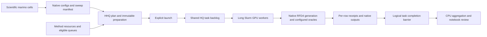

# RFD4 notebook adapter

The optional adapter consumes the **saved schema-1 `inference_sweep.write_sweep` manifest**. RFD4 retains input interpretation, diffusion, guidance, beam search, filters and configured refolding. HHQ owns allocations, task dispatch and bounded retry. The adapter does not call `launch_generate.sh` or `launch_sweep.sh` inside another allocation.



## Native submission or HHQ?

See [the native capability comparison](native-rfd4-comparison.md) for measured scope and remaining differences. The static-array comparison uses the same portable scientific driver as HHQ; it is not a benchmark of unmodified native launchers. A separate native-entrypoint control checks that boundary.

Native `launch_generate.sh` remains a reasonable direct option for a homogeneous array. It already processes multiple inputs/repeats with one loaded model, starts configured refolding workers and submits dependent metric aggregation. Use HHQ when a shared backlog spanning methods and resource profiles is useful. Do not put native `sbatch` launchers inside HHQ GPU tasks: that would reserve one allocation while submitting another, with competing recovery ownership.

Native requests are **declared**, not estimated. Its launcher loads shared settings and the user's `.user_info_<cluster>`, then explicit `--time`, `--mem` and CPU flags take precedence. `common.sh` writes those requests to Slurm. Its fallback walltime is four hours; if `MEM` is unset, no `--mem` directive is emitted and site defaults apply. It does not infer host RAM from beam width, length, AF3 usage or observed peaks. GPU VRAM remains a separate concern. These conclusions come from the inspected checkout's `scripts/common.sh` and `scripts/launch_generate.sh`; profile values are site/user settings, not portable recommended requests.

Native `--requeue` permits requeue; the optional advance signal and Lightning handler are separate pieces. In the inspected local Lightning 2.6.5, `SIGUSR1` calls `save_checkpoint()` and then `scontrol requeue` for the job or array task. Slurm restarts the batch script. Lightning can discover that HPC checkpoint on the next run, even with an already supplied model. However, standalone `Trainer.validate` resets its batch progress, and RFD4's model checkpoint does not serialize the active diffusion sample, beam branches or oracle call. **Requeue is not exact mid-inference continuation.** Container Lightning behavior was not separately tested.

| Progress before interruption | What can be reused |
| --- | --- |
| HHQ row has a valid completion receipt | Adapter verifies and skips that entire row. |
| Owned row has files but no completion receipt | The adapter preserves the entire unfinished output directory under its `.hhq-rfd4` sidecar, then restarts that row in an empty output directory. This prevents native `skip_existing` from accepting truncated files. |
| Finished AF3 prediction is cached | Native oracle cache may reuse it; its base cache predicate checks confidence JSON existence. An unfinished AF3 computation is not resumed mid-inference. |
| Active diffusion or gradient sample | Recomputed; no exact active-sample checkpoint restoration was found. |
| Beam candidate was explicitly saved | Native `search.save_states`, `search.resume_from` and `search.resume_seed` support a **new seeded continuation** from saved tensors and step. This is a separate scientific run with compatible inputs/settings and a fresh output directory, not an automatic retry. |

Native ordinary `skip_existing` matches root example IDs; beam output IDs have additional branch suffixes. By source inspection, beam files alone should not be treated as proof a root completed. HHQ's row receipts therefore remain useful. The explicit beam continuation requires compatible inputs, batch ordering, weights and schedule; native checks do not establish all of these. It does not restore interrupted RNG state and does not support gradient guidance, adapters or inverse folding. When deliberately preparing such a continuation, pin its state file as an external source too. HHQ never automatically selects a newest `.pt` file or rewrites the saved scientific configuration to resume it.

Useful native features to reuse are scientific execution, configured oracle caches, metric aggregation, explicit beam continuation and compatible batching/model reuse. The adapter does not add another scientific checkpoint format. Its retry/fencing rules remain independent of native checkpoints. Positive, exact-owned allocation interruption evidence can authorize bounded replay; unknown ownership, explicit user cancellation and task-specific errors do not become automatic recovery. See [recovery](recovery.md).

## Notebook changes

Keep the reference notebook's scientific sections, native `plan_sweep`, and `write_sweep` button. Replace its submission section (II.F in the AChE R1v3 reference) with four explicit controls:

1. **Plan:** read the saved manifest, verify hashes, show scientific calls and execution tasks.
2. **Prepare:** write immutable bundles/commands and a resource configuration on shared storage; preview queue eligibility. This does not import tasks, start HQ or submit Slurm jobs.
3. **Launch:** import one homogeneous child campaign per method into the same HQ service, then start the service if necessary.
4. **Status/collect:** inspect those logical tasks, then run the existing CPU collector when they are all terminal. Count scientific passers from native metrics separately.

[The standalone marimo example](../examples/rfd4_notebook.py) implements these controls outside any scientific campaign. Install HHQ in the notebook environment (for example `uv pip install -e /path/to/hyper-hyperqueue`); marimo remains optional. Opening the example performs no submission. Fill paths and copy/edit [the resource template](../examples/rfd4_options.yaml). Its unset values intentionally prevent an uncalibrated accidental launch.

In an existing live notebook, its agent should adapt these cells rather than overwrite the notebook. The current AChE example explicitly selects intact-ligand AF3 and custom catalytic geometry in its scientific cells; AF2 is excluded. Earlier notes about empty oracle settings describe the original starter, not the current campaign. HHQ does **not** fill scientific choices or silently add AF3.

## Resource configuration

Use separate `generate`, `gradient` and `beam` workload requests. Each task requests one GPU, one node and one rank. Choose broad **qualified** GPU placements, rather than inspecting which nodes happen to be idle. `gpu-small`, `gpu-large`, `gpu-backfill` and `gpu-train` are configured profile names, not universally portable Slurm partitions.

The [measured resource reference](rfd4-measured-resources.md) reports per-GPU and
recipe/thinking timings, first/later rows and whole-job memory from real
RFD4+AF3 work. Its current bounded follow-up uses 22 GiB **total** per allocation,
including the worker reserve, for gradient and beam. This is workload-specific
calibration, not a generic default or a measurement for vanilla generation.

`method_profiles(..., compatibility_constraint="auto")` applies the qualified
`Ampere|Lovelace|Hopper|Blackwell` guard on the inspected DIGS site, combined with
any existing profile constraint. Explicit `None` disables that application guard;
a string supplies another application guard. Other sites retain their configured
constraints under `auto`. Generic HHQ profiles remain hardware-neutral. An opt-out
does not qualify unsupported kernels: Titan RTX failed the inspected RFD4
attention path; AF3-only compatibility is a separate test.

```python
from hyper_hyperqueue.config import load_config, save_config
from hyper_hyperqueue.integrations.rfd4 import prepare, submission

# options is the completed YAML template; all paths are absolute/shared.
base = load_config(cluster_config_path)
config = submission.method_profiles(
    base,
    {method: spec["resources"] for method, spec in options["workloads"].items()},
    ["gpu-small", "gpu-large", "gpu-backfill", "gpu-train"],
)
plan = prepare.plan_sweep(native_manifest, **options)
prepared = prepare.prepare_sweep(plan, new_shared_directory)
save_config(config, new_shared_directory / "hhq-config.json")
resource_preview = submission.preview(prepared, config)
# A separate explicit notebook button:
receipt = submission.launch(prepared, config)
```

Preparation also creates the empty output parents and hashed `.hhq-rfd4` row
sidecar directories centrally, before publishing the package. This reduces
concurrent recursive directory creation on NFS workers. It creates no scientific
run directories, ownership records or completion receipts; those remain runtime
checks. Repeating the same preparation restores missing empty parents without
overwriting existing evidence. Planning and preview remain read-only. This is a
startup-race mitigation, not a guarantee against shared-filesystem outages.

`method_profiles` copies the existing partition, GRES, constraints, queue walltime, weights and budgets into method-specific profiles. It changes task host-RAM capacity plus the fixed worker reserve and ensures sufficient CPUs. Aliases are `rfd4-generate`, `rfd4-gradient`, `rfd4-beam`; use those in the options. Shared budgets are retained, not multiplied for each method. Set all method profiles **before** starting the service; HHQ rejects a changed configuration on an active service. Review the resolved configuration, including account/QoS and per-profile worker bounds, before launch.

An optional top-level `log_dir` keeps console logs separate from authoritative
`state_dir` metadata. For example, use `campaign/slurm/beta_functional_testing/state`
for state, `campaign/slurm/beta_functional_testing/prepared` for preparation, and
`campaign/logs/beta_functional_testing/hhq` for logs. Control and Slurm-worker
logs, HQ dispatch logs, application/validator streams and the owned native AF3
daemon log use this root. Attempt records retain the exact log directory, so
`hhq logs` and browser links continue to work. Scientific output paths are
unchanged. Leaving `log_dir` unset preserves the old layout. Set it before launch;
it is part of the immutable execution configuration.

For a staged functional check in a **fresh, inactive** state directory, import
with `launch(..., start_service=False)`, use `api.campaign_control(...,
"pause-dispatch")` for methods to hold, then start the CPU service. Release them
with `"resume-dispatch"` after checking initial outputs. This avoids cloning
scientific commands or changing output identities. With an already active
service, imports may run before a later pause; this procedure is not an atomic
pause of an existing service.

| Setting | Meaning |
| --- | --- |
| `memory_mib` | Host RAM for one task, including chosen application headroom. A measured 23 GiB peak plus 2 GiB means a 25 GiB task, not 32–48 GiB by default. This is an arithmetic example, not RFD4 calibration. The profile adds HHQ's fixed worker overhead. |
| `min_vram_mib`, `gpu_models` | Optional qualified device requirements, separate from host RAM. Do not declare every small GPU compatible without testing the actual configuration. |
| `runtime_seconds` | Estimate for the **entire bundle**; a shorter final bundle conservatively uses the same estimate. `declared` is an assumption, `measured` requires evidence. |
| `timeout_seconds` | Optional task kill deadline; different from its runtime estimate. |
| Profile `allocation_seconds` | Slurm worker walltime. Typically retain 8-hour workers, with longer train workers where intended and within the control lifetime. |
| `runs_per_task` | Number of unchanged scientific rows run sequentially in one task. Start at 1; increase after measuring startup cost and recovery granularity. |
| `max_attempts` | Total attempts, including the first. Defaults to 1. Setting 2 permits one qualifying recovery; it does not retry every scientific error. |

An optional per-workload `packing` block chooses a recipe-specific row count from
an explicit timing estimate. It requires `group_by_recipe=True`:

```python
workloads["beam"]["packing"] = {
    "target_seconds": 240 * 60,   # Soft four-hour bundle target.
    "fit_seconds": 235 * 60,      # Runtime admission estimate; leave cleanup room.
    "startup_seconds": 120,       # Replace from compatible cold-start measurements.
    "safety_factor": 1.1,
    "seconds_per_row": 1800,      # Example fallback assumption, not a measured default.
    "seconds_per_row_by_recipe": {recipe_id: measured_seconds_per_row},
}
```

The row cap is `floor((fit_seconds - startup_seconds) /
(seconds_per_row * safety_factor))`, also bounded by `runs_per_task`. The plan
reports the resulting estimate separately from the target and fit allowance.
Task `resources.runtime_seconds` remains `fit_seconds`, including shorter tails;
it is a fit check, not a kill deadline. Use costs matching GPU class, input length,
replicates, thinking and AF3 admission. If routes are heterogeneous, use a
conservative qualified-device estimate or prepare explicitly routed workloads.
This is transparent packing from supplied estimates, not automatic cross-GPU
learning. A 235-minute fit can permit two bundles in an eight-hour worker or three
in twelve hours, but startup, cleanup and estimation error can reduce that count.
Changing packing affects future preparations only; never rewrite active bundles.

Workers pull the next compatible task until their remaining lifetime is insufficient. A faster GPU naturally finishes more tasks during the same allocation; no fixed command count or node-free-time forecast is required. Task estimates and profile weights still affect allocation planning. Automatic cross-GPU timing adaptation is not implemented. Optional `retry.oom_memory_multipliers` enables bounded host-RAM increases after a positively identified host OOM; CUDA OOM does not trigger host-RAM escalation. Empty multipliers preserve fixed-RAM behavior. Inspect HHQ measurements and update **future** plans explicitly; never relabel guesses as measurements. Use budget `min_pending` to replenish a real pending reserve (for example 8 on `gpu`, 3 on `gpu-bf`, and 1 on opt-in `gpu-train`). Set profile `max_workers` and hard budget `max_submitted` high enough for both running and pending workers. Floors apply only to enabled compatible routes, share one task backlog, and taper near completion; they cannot override hard limits. `pending_reserve` alone is only legacy cap arithmetic. Set `policy.budget_priority: [gpu, gpu-train, gpu-bf]` to replenish regular GPU first, optional training second, and backfill last. This is submission preference, not a wait for job completion. The Pools page reports shortages and blockers. Keep completed pilot configurations frozen and use a new preparation for changed policy. For finite sweeps, enable `control.stop_when_complete`:
after all registered method campaigns settle, HHQ cancels owned pending workers,
waits for running workers to idle out, and shuts down the CPU service. The default
reconciliation interval is 15 seconds. Ready/paused/unknown work blocks shutdown;
final failures remain visible. See [recovery](recovery.md#finishing-a-partially-completed-command-file)
for remaining-only exports when changing resource requests. This preserves exact
bundle commands and completed-row reuse without changing scientific identities.

For calibration, compare startup time, task duration, sampled host RSS and actual GPU type separately for ordinary generation, guidance, beam/search and AF-enabled variants. Small bounded samples should precede a large scientific campaign. Process RSS can miss short peaks; check Slurm accounting too. Request observed peak plus a fixed headroom, not a percentage. Existing control-lifetime and preemption limits still apply; see [limitations](limitations.md).

## Scientific batching and model reuse

Each manifest row keeps its input, config, seed, output directory, `job_id=0` and `gen_njobs=1`. Native repeats and batch size are left untouched. The adapter deliberately does not merge multiple inputs into one scientific configuration: single-input guidance may reference `${inputs.0}`, and merging/reindexing can alter seeds.

Execution bundles group only compatible method/environment rows. They share a Python process and imports. `reuse_model: false` is the default. Opt-in model reuse uses native `load_ckpt_n_configure_inference` support and checks model identity/precision; LoRA adapters are rejected. **Cross-config model reuse is experimental until real GPU parity and memory tests pass.** It is not a claim of a persistent AF3 server shared across unrelated HHQ tasks.

For a new RFD4 preparation, set `group_by_recipe: true` and optionally
`execution_order: [gradient, beam, generate]`. Recipe grouping keeps each bundle
homogeneous across the full saved scientific YAML and environment, excluding only
the per-row `inputs`, `seed`, `out_dir`, and `run_name_` bindings and the exact
generated `hydra.run.dir: <out_dir>/hydra` output binding. References,
metrics, model weights, precision, thinking/noise settings, compile settings and
replicate counts remain part of compatibility. Explicit source-dependent reference
values therefore create different recipes; the adapter never rewrites them merely
to make larger batches. Within a recipe, rows are ordered by input path and run ID.
Seeds, per-input configurations and output paths are preserved. The preparation
summary reports recipe counts, ordered recipe groups and calls per group.

`execution_order` gives earlier methods higher static HQ task priority and orders
their command files; an explicit workload `priority` overrides that preference.
This is a **soft preference**, not a global completion barrier. Running work is
not preempted, incompatible workers may take another method, and HQ decides order
among equal-priority tasks. Recipe homogeneity inside each bundle is guaranteed;
strict recipe-by-recipe or method-by-method exhaustion is not. Keeping the backlog
available avoids idle allocations behind one slow or failed task. These options
are RFD4 adapter settings; the generic scheduler remains application-independent.
Both default to the prior behavior (`false` / `null`) for immutable compatibility.

Resetting run state does not inherently require clearing learned weights. Native
configuration rebuilds metrics, input/output bindings and search/guidance objects.
However, its current separate `Trainer.validate` calls move the model to CPU during
Lightning teardown. Opt-in `reuse_model` currently avoids repeated checkpoint loads
but does **not** guarantee uninterrupted GPU residency across rows. The owned AF3
daemon persists for the whole bundle, not across separate tasks. Also, native
seeding precedes model initialization; cold versus reused construction may consume
different random streams despite equal recorded seeds. Test actual output parity,
warm throughput and memory stability before treating this as a qualified scientific
replacement. A reusable model object alone is not that qualification.

## Runtime and recovery contract

Provide an explicit native Python executable or an explicit `apptainer exec ... /path/to/python` argument vector. The adapter does not use the private shell execution wrapper, whose detached oracle prelaunch could outlive the task's process group. Native Python imports and Hydra composition run in the scientific environment; HHQ itself does not depend on torch, Hydra, Lightning or RFD4.

Preparation binds input/config/native-source and runtime hashes. Runtime verifies them again before and after work. Each bundle carries its own row pins and shared software pins; the full preparation source inventory is stored once, avoiding a copy of every input/config in every task. Pin external custom provider code, checkpoints and container images through `runtime.source_hashes` where appropriate. Installed packages, environment values, remote weights and arbitrary external custom code are **not all frozen automatically**. Keep the pinned native checkout unchanged during a run or use a dedicated checkout.

The runtime:

- preserves allocated Slurm/GPU visibility and refuses conflicting environment overrides;
- supplies Lightning's real `SLURMEnvironment(auto_requeue=False)` through a scoped adapter, so Lightning cannot requeue the whole HHQ worker;
- locks each native output path and refuses to adopt unrelated nonempty outputs;
- records ownership, failures and atomic row receipts under a sibling `.hhq-rfd4/` directory;
- counts processed native dataset roots, including native evaluation of existing outputs, independently of how many structures survive filtering;
- validates completed artifacts before skipping a completed row on retry;
- publishes `rfd4_completion.json` in HHQ's attempt output only when every row has completed.

A successful process exit alone is insufficient. Missing root coverage and native early `SystemExit` are failures. A scientifically valid beam early-stop with no retained CIFs can still be complete when every requested root was processed. HHQ completion does not mean a good design or an AF3 prediction exists.

An interrupted bundle reuses its verified completed row receipts. An owned unfinished row is archived under `interrupted_outputs/` before retrying in an empty scientific output directory; `last_interrupted_output.json` records that preservation. This deliberately avoids native filename-only partial reuse and is **not bitwise RNG/checkpoint continuation**. Ordinary row errors stop that bundle. Generic recovery may retry positively identified allocation interruption or host OOM within the configured attempt/memory bounds. Unknown scheduler outcomes remain unknown; user cancellation wins, and no adapter bypass defeats ownership or attempt bounds.

Native AF3 setup may start its own task-local daemon when the scientific Python runs on the host. For a scientific Apptainer runtime, opt into `runtime.host_af3: {python: /usr/bin/python3}`. The native wrapper normally starts AF3 before entering its SIF; the optional HHQ host bridge provides that same ownership boundary without invoking the private shell wrapper or backgrounding a process. It sources the pinned native cluster profile, honors its semicolon-separated `APPTAINER_BIND_PATHS`, explicitly forwards configured allocator/cache/NCCL settings into the scientific image, starts the existing native `af3_daemon.py serve --lazy-warmup` on the allocated numeric GPU, binds its socket into the scientific container, and shuts it down when the scientific child exits. Both children remain in the generic runner's process group. The inner runtime accepts only the matching live bundle owner; unrelated inherited daemons remain forbidden. `--check` launches no daemon, does not load weights and does not qualify GPU execution.

Each scientific task uses its own temporary directory under node-local `/tmp`,
explicitly bound into the container. It does not share Slurm's job-wide `TMPDIR`
between commands. Scratch and AF3 ownership/socket files are separate; deleting
scratch cannot remove the daemon's ownership record. Warm rows recreate their
scratch directory and refresh Python's cached temporary-directory selection.
Only these adapter-owned temporary directories are cleaned at exit.

An optional `host_af3.adapter` can supply a qualified frozen compatible daemon/worker pair, environment and bound source hashes (for an external exact-input prediction cache, for example). Qualification belongs to that adapter; pass only its validated options. HHQ pins the returned scripts/configuration/evidence and retains ownership of the one host daemon. It does not wrap another daemon-owning command, decide chemical equivalence, or add a second cache. No adapter is selected by default.

Current native oracle transport expects one numeric `CUDA_VISIBLE_DEVICES`; UUID/multi-device paths are rejected rather than rewritten. Native/Apptainer AF3 execution, daemon cleanup under real allocation failures, and model reuse require separate GPU qualification. An oracle's presence in YAML is not proof that it ran or that its ligand inputs were correct.

## CLI and collection

```bash
hhq rfd4 plan /shared/sweep_manifest.json /shared/rfd4-options.yaml
hhq rfd4 prepare /shared/sweep_manifest.json /shared/rfd4-options.yaml /shared/new-hhq-plan
hhq --config /shared/new-hhq-plan/hhq-config.json rfd4 preview /shared/new-hhq-plan/prepared.json
hhq --config /shared/new-hhq-plan/hhq-config.json rfd4 launch /shared/new-hhq-plan/prepared.json
hhq --config /shared/new-hhq-plan/hhq-config.json rfd4 status /shared/new-hhq-plan/prepared.json --reconcile
hhq --config /shared/new-hhq-plan/hhq-config.json rfd4 collection-ready /shared/new-hhq-plan/prepared.json
```

The CLI does not synthesize method profiles: save the complete configuration through the notebook/Python helper first, or configure suitable profiles explicitly. Repeated identical preparation is idempotent; changed files require a new directory. `launch(start_service=False)` still imports **runnable** tasks into an existing service: it is not a dry run. Use `preview` for that. Partial launch progress is recorded and identical imports deduplicate; an uncertain service-start acknowledgement requires reconciliation before a new start. The launch receipt binds its entire configuration; relaunching with changed budgets/resources is not a capacity-adjustment interface. Use the generic pool/control operations and supported explicit restart procedure; do not duplicate scientific work to change capacity.

`collection_ready` checks whether all logical tasks are terminal, reports failures/cancellations, and blocks pending retries or unknown outcomes. This is a point-in-time observation, not a freeze against later operator actions. It does not wait for long worker allocations to end. Historical status and collection validate saved execution snapshots without requiring the live native checkout to remain unchanged forever; preview and launch still verify all live source pins. `submission.submit_aggregation` can explicitly submit an existing collector command file through direct CPU arrays after that barrier. Pooled CPU remains available through the generic API. There is no separate adapter controller, automatic scientific DAG or automatic candidate filtering.

Each prepared bundle also supports a CPU-only native preflight: append `--check` to its saved `argv`. This verifies hashes, imports the actual native interface and composes configs without loading weights, generation, Trainer construction or output ownership. It is distinct from a GPU execution test.

## Code organization

The optional adapter has four responsibilities; the generic scheduler never imports RFD4:

| Module | Responsibility |
| --- | --- |
| `prepare.py` | Read the saved native sweep; verify and write immutable execution bundles. |
| `runtime.py` | Run native calls inside the selected scientific environment; verify owned outputs and row completion. It is standalone, so it uses standard-library file/lock helpers rather than importing HHQ into the RFD4 environment. |
| `host_runtime.py` | Optional foreground owner for the native host AF3 daemon and scientific container; no scheduling or cache policy. |
| `submission.py` | Map bundles onto existing HHQ APIs and resource profiles; report logical completion. |
| `cli.py` | Thin command-line entry points. |

The core runner owns attempt/retry decisions; the RFD4 runtime owns scientific output rows. These are different scopes. Keep one authoritative retry policy and one campaign-identity implementation. Reuse existing native APIs instead of copying generation logic or adding another scheduling service.

## Validation status

See [validation](validation.md) for exact tested paths and dates. Synthetic adapter
tests exercise preparation, tampering, output collisions, coverage, interrupted
continuation and imports/recovery. Subsequent bounded scientific controls and a
heterogeneous comparison exercised real RFD4+AF3, warm bundles, automatic
preemption recovery and completion shutdown. The [resource reference](rfd4-measured-resources.md)
separates those measurements from unqualified GPU models, exact RNG parity and
multi-day service renewal. Earlier implementation-only records remain historical;
generic CUDA tests alone do not qualify the scientific path.
